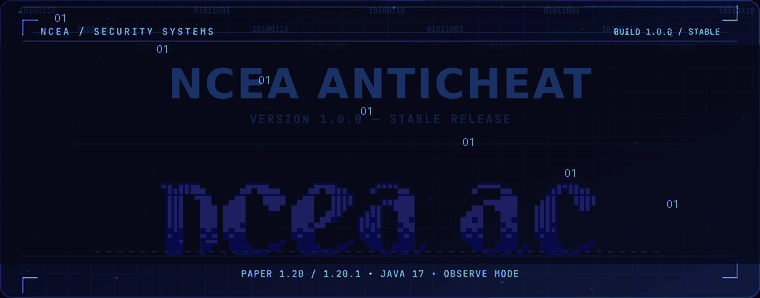
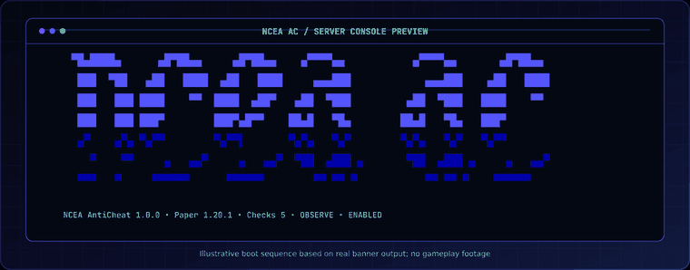

<div align="center">

[Русский](README.md) · **English**

<picture><source media="(prefers-reduced-motion: reduce)" srcset="docs/assets/readme/hero.svg" /></picture>

**Minecraft Server AntiCheat by [NCEA Studio](https://ncea-studio.com)**

     [](https://github.com/Yozekkk/NCEA-anticheat/actions/workflows/ci.yml)

[Install](#installation) · [Checks](#detection-engine) · [Console](#ncea-ac-console) · [Docs](docs/INDEX.md) · [Русский](README.md)

</div>



## System

NCEA AntiCheat is NCEA Studio's modular Paper plugin. **0.1.0 Development** collects suspicious movement, combat and placement evidence, maintains an independent violation level (VL) for each check, and alerts staff. The default **OBSERVE** mode neither cancels player actions nor issues automatic bans.



> [!IMPORTANT]
> This is a development build with heuristics. No connected-client gameplay validation, detection rate, or real false-positive rate has been measured. A successful server startup is not a PvP test.

## Detection engine



| Check | Signal | State |
|---|---|---|
| **Speed** | Horizontal distance in short `PlayerMoveEvent` windows | Working heuristic |
| **Fly** | Sustained near-zero vertical movement off ground | Working heuristic |
| **Reach** | Eye-to-server-hitbox distance on a damaging attack | Working, no packet history compensation |
| **AutoClicker** | Unique successful attacks within one second | Working; does not count all clicks |
| **FastPlace** | Intervals between successful block placements | Working heuristic |

Context exemptions, ping, TPS, and server movement grace windows reduce obvious false signals. One signal does not establish cheating. [Mechanisms and limitations](docs/CHECKS.en.md).

## Architecture



`ncea-core` contains observations, checks, VL/decay, player data, and branding without Paper imports. `ncea-paper` handles Paper events, exemptions, YAML, commands, and lifecycle. Shared sources compile separately against Paper API **1.20** and **1.20.1**. [Architecture notes](docs/ARCHITECTURE.md).

## NCEA AC console



<details><summary>Show the real monochrome logo output</summary>

```text
▀█▄████▄      ▄█▀██▄▄     ▄█▀██▄▄    ▄▀▀▀▀▄▄           ▄▀▀▀▀▄▄       ▄█▀██▄▄ 
 ███  ▀██   ▄██   ████  ▄██   ████     ▄▄▄███            ▄▄▄███    ▄██   ████
 ███   ███ ████    ▀▀  ████  ▄██▀   ▄██  ▀███         ▄██  ▀███   ████    ▀▀ 
 ███   ███ ███▀        ███▀▄█▀▀    ██▄█   ▀█▄        ██▄█   ▀█▄   ███▀       
 ▄▀    ▄▀▄ ▀▄▀▀        ▀▄▀▀▌       ▀▄▀▄   ▀▄▀        ▀▄▀▄   ▀▄▀   ▀▄▀▀       
   ▀    ▀▀     ▄   ▄▄▀     ▄   ▄▄▀  ▀██  ▄███ ▄       ▀██  ▄███ ▄     ▄   ▄▄▀
 ▀▀▀   ▀     ▀▀▀▀▀▀      ▀▀▀▀▀▀        ▀▀ ▀▀ ▀           ▀▀ ▀▀ ▀    ▀▀▀▀▀▀   
```

The geometry comes from the [provided Bash source](Ascii/NCEA_AC_original_banner.sh), alongside the [original image](Ascii/Ascii%20final%20result.png). Java never executes Bash to render it.

</details>



*This GIF previews branding, not gameplay.* Terminal colors use conservative auto detection; ANSI 16/256/TrueColor, themes, Unicode/ASCII, and safe custom templates are available. [Branding guide](docs/CONSOLE_BRANDING.md) · [Custom banner](docs/BANNER_CUSTOMIZATION.md).

## Configuration

First start creates `config.yml`, `checks.yml`, `branding.yml`, and `custom-banner.txt` under `plugins/NCEAAntiCheat/`.

```yaml
# branding.yml
branding:
  banner:
    style: original-3d
    charset: unicode
  console:
    colors: auto
    color-mode: ansi16
  theme:
    name: ncea-original
```

```yaml
# checks.yml excerpt
checks:
  speed:
    enabled: true
    weight: 1.0
    decay: 0.15
    alert-threshold: 5.0
```

`/nceaac reload` validates settings before applying them. OBSERVE mode does not punish players. [Check configuration](docs/CONFIGURATION.en.md) · [Branding reference](docs/CONFIG_REFERENCE.md) · [Presets](presets/).

## Installation

1. Download the JAR matching your Paper version from the [v0.1.0-dev.0 prerelease](https://github.com/Yozekkk/NCEA-anticheat/releases/tag/v0.1.0-dev.0).
2. Put it in `plugins/` on **Paper 1.20 or 1.20.1** running **Java 17**.
3. Start the server and check for `Status ENABLED` beneath the logo.
4. Run `/nceaac status`, `/nceaac checks`, and `/nceaac config validate`.
5. Edit the YAML files and run `/nceaac reload`.

<details><summary>Build and preview locally</summary>

```bash
./gradlew clean build
./gradlew :ncea-paper:previewBanner
```

A full JDK is needed to build. Sources compile with `--release 17`; both JARs appear in `dist/`. [Installation details](docs/INSTALLATION.en.md) · [Compatibility](docs/COMPATIBILITY.md).

</details>

## Commands

| Command | Purpose |
|---|---|
| `/nceaac status` · `/nceaac version` | Version and status |
| `/nceaac checks` | Five check states |
| `/nceaac alerts` | Toggle staff alerts |
| `/nceaac violations <player>` | Online player's VL and latest evidence |
| `/nceaac reset <player>` | Clear VL and temporary counters |
| `/nceaac exempt <player>` · `/nceaac unexempt <player>` | Temporary exemption |
| `/nceaac reload` · `/nceaac config validate` | YAML reload and validation |
| `/nceaac performance` | Local counters and check timing |

`/nceaac help` lists commands; `profile` and `debug` currently share the `violations` output. [All commands](docs/COMMANDS.md) · [Permissions](docs/PERMISSIONS.md).

## Testing

| Test | Actual result |
|---|---|
| JUnit 5 | **77 tests**, 0 failures (60 core, 17 Paper) |
| JaCoCo | Core **81.4%** line coverage; Paper **49.2%** |
| Paper 1.20 / 1.20.1 | Local cold and repeat startup on Java 17 |
| Banner variants | 16 server starts, eight variants on each version |
| Connected client | Not tested |

[Method](docs/TESTING.md) · [Results](docs/TEST_RESULTS.md) · [QA](docs/QA_REPORT.md) · [Performance](docs/PERFORMANCE.md).

## Roadmap

| Available now | Planned |
|---|---|
| Five observe-mode checks, VL/decay, exemptions, alerts, commands, branding | Packet inspection, physical simulation, more precise latency compensation, client-based PvP tests, false-positive and TPS measurements |

Automatic punishment and setbacks need separate implementation and gameplay validation. [Known limitations](docs/KNOWN_LIMITATIONS.md).

## Documentation and provenance

[Docs index](docs/INDEX.md) · [Quick start](docs/GETTING_STARTED.en.md) · [Development](docs/DEVELOPMENT.md) · [File map](docs/FILE_MANIFEST.md) · [Changelog](docs/CHANGELOG.md)

The original product source was written for NCEA Studio. [LICENSE](LICENSE) currently states **All rights reserved** and grants no right to copy or modify the source. No code from the researched GPL/AGPL anticheats is bundled. Third-party sources and tool licenses are recorded in the [audit](docs/THIRD_PARTY_AUDIT.md).


