<div align="center">

[РУССКИЙ](README.md) · [**ENGLISH**](README.en.md)

<picture><source media="(prefers-reduced-motion: reduce)" srcset="docs/assets/angelos-adapted/header.png" /></picture>

**NCEA AntiCheat 1.0.0 Stable** · Paper 1.20 / 1.20.1 · Java 17

[NCEA Studio](https://ncea-studio.com) · [Download release](https://github.com/Yozekkk/NCEA-anticheat/releases/tag/v1.0.0) · [Documentation](docs/INDEX.md)

</div>

<div align="center">

<picture><source media="(prefers-reduced-motion: reduce)" srcset="docs/assets/angelos-adapted/cobweb-tl.png" /></picture>
<picture><source media="(prefers-reduced-motion: reduce)" srcset="docs/assets/angelos-adapted/stamp-evidence.png" /></picture>

</div>

> **NCEA case file / 12 tapes.** This visual narrative describes the product that actually shipped. Images marked *schematic* are conceptual illustrations, not gameplay test footage. The adapted VHS artwork is based on the MIT-licensed [AngelOS-Dotfiles](https://github.com/MixaDoDs/AngelOS-Dotfiles) © 2026 MixaDoDs. [Asset credits](docs/ASSET_CREDITS.md).


<picture><source media="(prefers-reduced-motion: reduce)" srcset="docs/assets/angelos-adapted/divider.png" /></picture>

<picture><source media="(prefers-reduced-motion: reduce)" srcset="docs/assets/angelos-adapted/tape-01.png" /></picture>

### 01 · The NCEA case

The server observes events. NCEA AntiCheat turns them into evidence, maintains a separate **Violation Level** for each check, and alerts staff. **1.0.0 Stable** is the owner's decision to release the current feature set. The default **OBSERVE** mode does not cancel player actions or issue automatic bans.

<picture><source media="(prefers-reduced-motion: reduce)" srcset="docs/assets/angelos-adapted/demos/stable-release.png" /></picture>

<details><summary>✉ Inventory 01 · what works now</summary>

Five checks: **Speed**, **Fly**, **Reach**, **AutoClicker**, and **FastPlace**. Contextual exemptions, VL accumulation and decay, alerts, commands, and configuration are included. Packet checks and predictive physics are not. [Known limitations](docs/KNOWN_LIMITATIONS.md).

</details>

<picture><source media="(prefers-reduced-motion: reduce)" srcset="docs/assets/angelos-adapted/divider.png" /></picture>

<picture><source media="(prefers-reduced-motion: reduce)" srcset="docs/assets/angelos-adapted/tape-02.png" /></picture>

### 02 · Connect the server

Choose **one** JAR matching your Paper version and place it in `plugins/` on a Java 17 server. Start Paper, then inspect the status and generated settings.

<picture><source media="(prefers-reduced-motion: reduce)" srcset="docs/assets/angelos-adapted/demos/commands.png" /></picture>

<details><summary>✉ Inventory 02 · downloads and first commands</summary>

| Server | File |
|---|---|
| Paper 1.20 | [NCEA-AntiCheat-1.20.jar](https://github.com/Yozekkk/NCEA-anticheat/releases/download/v1.0.0/NCEA-AntiCheat-1.20.jar) |
| Paper 1.20.1 | [NCEA-AntiCheat-1.20.1.jar](https://github.com/Yozekkk/NCEA-anticheat/releases/download/v1.0.0/NCEA-AntiCheat-1.20.1.jar) |

```text
/nceaac status
/nceaac checks
/nceaac config validate
```

[Installation guide](docs/INSTALLATION.en.md) · [Compatibility](docs/COMPATIBILITY.md).

</details>

<picture><source media="(prefers-reduced-motion: reduce)" srcset="docs/assets/angelos-adapted/divider.png" /></picture>

<picture><source media="(prefers-reduced-motion: reduce)" srcset="docs/assets/angelos-adapted/tape-03.png" /></picture>

### 03 · The evidence reel

Each check contributes its own signal. The engine applies weight, threshold, cooldown, and VL decay over time. One unusual event is not proof of cheating.

<picture><source media="(prefers-reduced-motion: reduce)" srcset="docs/assets/angelos-adapted/demos/violations.png" /></picture>

<details><summary>✉ Inventory 03 · technical model</summary>

Checks process normalized Paper events. VL is independent per player and check. Exemptions and low TPS can suppress signals. `/nceaac violations <player>` shows the latest evidence. [Architecture](docs/ARCHITECTURE.md) · [Settings](docs/CONFIGURATION.en.md).

</details>

<picture><source media="(prefers-reduced-motion: reduce)" srcset="docs/assets/angelos-adapted/divider.png" /></picture>

<picture><source media="(prefers-reduced-motion: reduce)" srcset="docs/assets/angelos-adapted/tape-04.png" /></picture>

### 04 · Coordinates in motion

**Speed** analyzes horizontal displacement in short `PlayerMoveEvent` windows. **Fly** looks for sustained near-zero vertical movement away from the ground. Teleports, effects, knockback, and server lag change the legitimate movement envelope.

<picture><source media="(prefers-reduced-motion: reduce)" srcset="docs/assets/readme/speed-demo.svg" /></picture>
<picture><source media="(prefers-reduced-motion: reduce)" srcset="docs/assets/readme/fly-demo.svg" /></picture>

<details><summary>✉ Inventory 04 · false positives</summary>

These are heuristics; they do not simulate every Minecraft physics rule. Review evidence, ping, TPS, and movement context before considering sanctions. [Check details](docs/CHECKS.en.md).

</details>

<picture><source media="(prefers-reduced-motion: reduce)" srcset="docs/assets/angelos-adapted/divider.png" /></picture>

<picture><source media="(prefers-reduced-motion: reduce)" srcset="docs/assets/angelos-adapted/tape-05.png" /></picture>

### 05 · The moment of attack

**Reach** measures distance from the attacker's eyes to the server-side target hitbox. **AutoClicker** counts distinct successful attacks per second. Packet history is not reconstructed, and the plugin cannot observe every physical mouse click.

<picture><source media="(prefers-reduced-motion: reduce)" srcset="docs/assets/readme/reach-demo.svg" /></picture>
<picture><source media="(prefers-reduced-motion: reduce)" srcset="docs/assets/readme/autoclicker-demo.svg" /></picture>

<details><summary>✉ Inventory 05 · measurement limits</summary>

Ping and delay are treated conservatively. One fast attack does not trigger a punishment. [Thresholds and methods](docs/CHECKS.en.md).

</details>

<picture><source media="(prefers-reduced-motion: reduce)" srcset="docs/assets/angelos-adapted/divider.png" /></picture>

<picture><source media="(prefers-reduced-motion: reduce)" srcset="docs/assets/angelos-adapted/tape-06.png" /></picture>

### 06 · Block after block

**FastPlace** observes intervals between successful block placements. It is the only implemented world check in 1.0.0; Scaffold, Nuker, and similar names are not presented as working features.

<picture><source media="(prefers-reduced-motion: reduce)" srcset="docs/assets/readme/fastplace-demo.svg" /></picture>

<details><summary>✉ Inventory 06 · context</summary>

Server lag, legitimate fast building, and temporary exemptions affect the signal. OBSERVE mode lets staff review alerts without automatic sanctions. [Check reference](docs/CHECKS.en.md).

</details>

<picture><source media="(prefers-reduced-motion: reduce)" srcset="docs/assets/angelos-adapted/cobweb-divider.png" /></picture>

<picture><source media="(prefers-reduced-motion: reduce)" srcset="docs/assets/angelos-adapted/tape-07.png" /></picture>

### 07 · Tune the signal

`config.yml`, `checks.yml`, and `branding.yml` are created under `plugins/NCEAAntiCheat/`. Invalid settings do not replace the active configuration on reload.

<picture><source media="(prefers-reduced-motion: reduce)" srcset="docs/assets/readme/config-demo.svg" /></picture>

<details><summary>✉ Inventory 07 · a short excerpt</summary>

```yaml
# checks.yml
checks:
  speed:
    enabled: true
    weight: 1.0
    decay: 0.15
    alert-threshold: 5.0
```

```text
/nceaac reload
/nceaac config validate
```

[Configuration](docs/CONFIGURATION.en.md) · [Branding reference](docs/CONFIG_REFERENCE.md).

</details>

<picture><source media="(prefers-reduced-motion: reduce)" srcset="docs/assets/angelos-adapted/cobweb-divider.png" /></picture>

<picture><source media="(prefers-reduced-motion: reduce)" srcset="docs/assets/angelos-adapted/tape-08.png" /></picture>

### 08 · NCEA AC on startup

The real pixel geometry of the console mark comes from the [owner's supplied image](Ascii/Ascii%20final%20result.png). The banner appears only after successful initialization. Color Unicode, monochrome, ASCII, compact, and custom modes are configured through `branding.yml`.

<picture><source media="(prefers-reduced-motion: reduce)" srcset="docs/assets/angelos-adapted/demos/paper-startup.png" /></picture>

<details><summary>✉ Inventory 08 · safe output</summary>

Automatic ANSI detection is conservative; an unsuitable terminal must not block plugin startup. [Console branding](docs/CONSOLE_BRANDING.md) · [Custom banner](docs/BANNER_CUSTOMIZATION.md).

</details>

<picture><source media="(prefers-reduced-motion: reduce)" srcset="docs/assets/angelos-adapted/cobweb-divider.png" /></picture>

<picture><source media="(prefers-reduced-motion: reduce)" srcset="docs/assets/angelos-adapted/tape-09.png" /></picture>

### 09 · How an event travels

`ncea-paper` receives events and builds context. `ncea-core` holds player state, checks, VL, and the banner renderer. Shared code compiles separately against Paper API 1.20 and 1.20.1.

<picture><source media="(prefers-reduced-motion: reduce)" srcset="docs/assets/readme/architecture.svg" /></picture>

<details><summary>✉ Inventory 09 · modules</summary>

Core has no Bukkit imports. Paper API stays on the appropriate server thread. Player state is cleared on disconnect. [Architecture](docs/ARCHITECTURE.md) · [Development](docs/DEVELOPMENT.md).

</details>

<picture><source media="(prefers-reduced-motion: reduce)" srcset="docs/assets/angelos-adapted/cobweb-divider.png" /></picture>

<picture><source media="(prefers-reduced-motion: reduce)" srcset="docs/assets/angelos-adapted/tape-10.png" /></picture>

### 10 · A report, not a promise

**77 JUnit tests passed with zero failures.** Separate local Paper 1.20 and 1.20.1 servers on Java 17 passed cold and repeat starts. JaCoCo line coverage is **81.4%** for core and **49.2%** for the Paper adapter.

<picture><source media="(prefers-reduced-motion: reduce)" srcset="docs/assets/readme/testing-panel.svg" /></picture>

<details><summary>✉ Inventory 10 · test boundaries</summary>

No Minecraft client was connected. Real detection and false-positive rates, PvP load, and hosting web consoles were not measured. [Results](docs/TEST_RESULTS.md) · [Method](docs/TESTING.md) · [QA](docs/QA_REPORT.md).

</details>

<picture><source media="(prefers-reduced-motion: reduce)" srcset="docs/assets/angelos-adapted/cobweb-divider.png" /></picture>

<picture><source media="(prefers-reduced-motion: reduce)" srcset="docs/assets/angelos-adapted/tape-11.png" /></picture>

### 11 · Navigate the archive

User guides, check definitions, and developer notes live in `docs/`. Searchable Markdown remains the primary source; artwork supports the narrative.

<picture><source media="(prefers-reduced-motion: reduce)" srcset="docs/assets/readme/documentation-panel.svg" /></picture>

<details><summary>✉ Inventory 11 · open the files</summary>

[Index](docs/INDEX.md) · [Quick start](docs/GETTING_STARTED.en.md) · [Commands](docs/COMMANDS.md) · [Permissions](docs/PERMISSIONS.md) · [Checks](docs/CHECKS.en.md) · [Troubleshooting](docs/TROUBLESHOOTING.md) · [Changelog](docs/CHANGELOG.md).

</details>

<picture><source media="(prefers-reduced-motion: reduce)" srcset="docs/assets/angelos-adapted/cobweb-divider.png" /></picture>

<picture><source media="(prefers-reduced-motion: reduce)" srcset="docs/assets/angelos-adapted/tape-12.png" /></picture>

### 12 · End of tape, start of work

**NCEA Studio** releases the current product as **1.0.0 Stable** for Paper 1.20/1.20.1. Future work includes packet inspection, more precise physics, and gameplay validation. None is claimed as implemented today.

<picture><source media="(prefers-reduced-motion: reduce)" srcset="docs/assets/angelos-adapted/demos/stable-release.png" /></picture>

<details><summary>✉ Inventory 12 · rights, provenance, release</summary>

NCEA code remains [All rights reserved](LICENSE). Adapted AngelOS SVGs retain **MIT © 2026 MixaDoDs**; embedded fonts retain their own MIT/OFL notices. [Asset credits](docs/ASSET_CREDITS.md) · [Visual audit](docs/README_VISUAL_AUDIT.md) · [Third-party audit](docs/THIRD_PARTY_AUDIT.md) · [Release Notes](docs/RELEASE_NOTES_1.0.0.md).

</details>

<picture><source media="(prefers-reduced-motion: reduce)" srcset="docs/assets/angelos-adapted/end.png" /></picture>

<div align="center">

[NCEA Studio](https://ncea-studio.com) · [GitHub Release](https://github.com/Yozekkk/NCEA-anticheat/releases/tag/v1.0.0) · [Русский](README.md)

</div>
