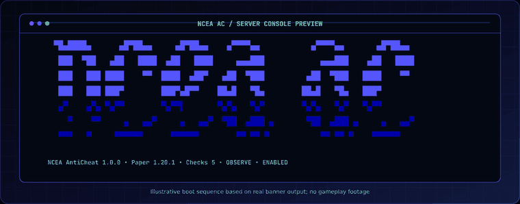

<div align="center">

**Русский** · [English](README.en.md)



**Minecraft Server AntiCheat by [NCEA Studio](https://ncea-studio.com)**

     [](https://github.com/Yozekkk/NCEA-anticheat/actions/workflows/ci.yml)

[Установка](#установка) · [Проверки](#движок-обнаружения) · [Консоль](#консоль-ncea-ac) · [Документация](docs/INDEX.md) · [English](README.en.md)

</div>



## Система

NCEA AntiCheat — самостоятельный модульный Paper-плагин студии NCEA. Версия **0.1.0 Development** собирает признаки подозрительного движения, боя и установки блоков, ведёт независимый Violation Level (VL) для каждой проверки и показывает уведомления персоналу. По умолчанию работает в режиме **OBSERVE**: действие игрока не отменяется, автоматические баны не выдаются.



> [!IMPORTANT]
> Это development-сборка с эвристиками. Игровые испытания с подключённым клиентом, реальные доли обнаружения и ложных срабатываний ещё не измерены. Результаты сборки и запуска сервера не заменяют PvP-тестирование.

## Движок обнаружения



| Проверка | Что измеряет | Статус |
|---|---|---|
| **Speed** | Горизонтальное смещение в коротком окне `PlayerMoveEvent` | Работает, эвристика |
| **Fly** | Длительное почти нулевое вертикальное смещение вне земли | Работает, эвристика |
| **Reach** | Расстояние от глаз до серверного hitbox цели при уроне | Работает, без компенсации истории пакетов |
| **AutoClicker** | Число уникальных успешных атак за секунду | Работает, не измеряет все клики |
| **FastPlace** | Интервалы между успешными установками блоков | Работает, эвристика |

Проверки учитывают контекстные исключения, ping, TPS и окна после серверных изменений движения. Одиночный сигнал не означает доказанный чит. [Механизмы, пороги и false positives](docs/CHECKS.md).

## Архитектура



`ncea-core` не зависит от Paper: наблюдения, проверки, VL/decay, данные игроков и рендерер. `ncea-paper` обрабатывает события, исключения, YAML, команды и жизненный цикл. Один общий исходный набор отдельно компилируется против Paper API **1.20** и **1.20.1**. [Техническая схема](docs/ARCHITECTURE.md).

## Консоль NCEA AC



<details>
<summary>Открыть настоящий монохромный вывод логотипа</summary>

```text
▀█▄████▄      ▄█▀██▄▄     ▄█▀██▄▄    ▄▀▀▀▀▄▄           ▄▀▀▀▀▄▄       ▄█▀██▄▄ 
 ███  ▀██   ▄██   ████  ▄██   ████     ▄▄▄███            ▄▄▄███    ▄██   ████
 ███   ███ ████    ▀▀  ████  ▄██▀   ▄██  ▀███         ▄██  ▀███   ████    ▀▀ 
 ███   ███ ███▀        ███▀▄█▀▀    ██▄█   ▀█▄        ██▄█   ▀█▄   ███▀       
 ▄▀    ▄▀▄ ▀▄▀▀        ▀▄▀▀▌       ▀▄▀▄   ▀▄▀        ▀▄▀▄   ▀▄▀   ▀▄▀▀       
   ▀    ▀▀     ▄   ▄▄▀     ▄   ▄▄▀  ▀██  ▄███ ▄       ▀██  ▄███ ▄     ▄   ▄▄▀
 ▀▀▀   ▀     ▀▀▀▀▀▀      ▀▀▀▀▀▀        ▀▀ ▀▀ ▀           ▀▀ ▀▀ ▀    ▀▀▀▀▀▀   
```

Геометрия перенесена из [исходного Bash-шаблона](Ascii/NCEA_AC_original_banner.sh); также в проекте есть [оригинальное изображение](Ascii/Ascii%20final%20result.png). Java не запускает Bash для вывода.

</details>



*GIF показывает оформление логотипа, а не игровой детектор.* Цвета в серверной консоли включаются консервативно; доступны ANSI 16/256/TrueColor, темы, Unicode/ASCII и пользовательский безопасный шаблон. [Руководство по оформлению](docs/CONSOLE_BRANDING.md) · [Свой баннер](docs/BANNER_CUSTOMIZATION.md).

## Конфигурация

Плагин создаёт `config.yml`, `checks.yml`, `branding.yml` и `custom-banner.txt` в `plugins/NCEAAntiCheat/`. Пример:

```yaml
# branding.yml
branding:
  banner:
    style: original-3d
    charset: unicode
  console:
    colors: auto
    color-mode: ansi16
  theme:
    name: ncea-original
```

```yaml
# checks.yml — фрагмент; остальные проверки остаются в файле
checks:
  speed:
    enabled: true
    weight: 1.0
    decay: 0.15
    alert-threshold: 5.0
```

`/nceaac reload` валидирует новые настройки до применения. Режим OBSERVE не выдаёт наказаний. [Конфигурация проверок](docs/CONFIGURATION.md) · [Справочник branding.yml](docs/CONFIG_REFERENCE.md) · [Пресеты](presets/).

## Установка

1. Скачайте JAR для вашей версии Paper из [предварительного релиза v0.1.0-dev.0](https://github.com/Yozekkk/NCEA-anticheat/releases/tag/v0.1.0-dev.0).
2. Поместите JAR в папку `plugins/` сервера **Paper 1.20 или 1.20.1**, работающего на **Java 17**.
3. Запустите сервер и дождитесь сообщения `Status ENABLED` под логотипом.
4. Проверьте `/nceaac status`, `/nceaac checks`, `/nceaac config validate`.
5. Настройте созданные YAML и выполните `/nceaac reload`.

<details>
<summary>Сборка из исходников и локальный предпросмотр</summary>

```bash
./gradlew clean build
./gradlew :ncea-paper:previewBanner
```

Для сборки нужен полный JDK. Исходники компилируются с `--release 17`; итоговые JAR находятся в `dist/`. [Подробная установка](docs/INSTALLATION.md) · [Совместимость](docs/COMPATIBILITY.md).

</details>

## Команды

| Команда | Назначение |
|---|---|
| `/nceaac status` · `/nceaac version` | Версия и состояние |
| `/nceaac checks` | Включённость пяти проверок |
| `/nceaac alerts` | Переключить уведомления для сотрудника |
| `/nceaac violations <player>` | VL и последнее доказательство игрока онлайн |
| `/nceaac reset <player>` | Сбросить VL и временные счётчики |
| `/nceaac exempt <player>` · `/nceaac unexempt <player>` | Временное исключение |
| `/nceaac reload` · `/nceaac config validate` | Перезагрузка и валидация YAML |
| `/nceaac performance` | Локальные счётчики и время проверок |

`/nceaac help` показывает список; `profile` и `debug` сейчас используют тот же вывод, что `violations`. [Все команды](docs/COMMANDS.md) · [Права](docs/PERMISSIONS.md).

## Проверка качества

| Проверка | Фактический результат |
|---|---|
| JUnit 5 | **77 тестов**, 0 ошибок (60 core, 17 Paper) |
| JaCoCo | Core **81,4%** строк; Paper **49,2%** |
| Paper 1.20 / 1.20.1 | Холодный и повторный локальный запуск на Java 17 |
| Режимы баннера | 16 серверных запусков, восемь режимов на каждой версии |
| Игровой клиент | Не тестировался |

[Методика](docs/TESTING.md) · [Результаты и логи](docs/TEST_RESULTS.md) · [QA](docs/QA_REPORT.md) · [Производительность](docs/PERFORMANCE.md).

## Дальнейшая работа

| Сейчас | Планируется |
|---|---|
| 5 наблюдательных проверок, VL/decay, исключения, уведомления, команды, брендирование | Пакетный слой, симуляция физики, более точная компенсация задержки, игровые PvP-тесты, измерение false positives и TPS |

Автоматические наказания и setbacks требуют отдельной реализации и игровых испытаний; в этой версии они отсутствуют. [Известные ограничения](docs/KNOWN_LIMITATIONS.md).

## Документация и происхождение

[Оглавление](docs/INDEX.md) · [Быстрый старт](docs/GETTING_STARTED.md) · [Разработка](docs/DEVELOPMENT.md) · [Карта файлов](docs/FILE_MANIFEST.md) · [История изменений](docs/CHANGELOG.md)

Исходный код продукта разработан для NCEA Studio. Проект распространяется с уведомлением **All rights reserved** в [LICENSE](LICENSE); разрешение на копирование или переработку исходников этим уведомлением не предоставлено. Код исследованных GPL/AGPL-античитов в проект не включён. Лицензии и источники использованных инструментов описаны в [аудите сторонних компонентов](docs/THIRD_PARTY_AUDIT.md).


