<div align="center">

[**РУССКИЙ**](README.md) · [ENGLISH](README.en.md)

<picture><source media="(prefers-reduced-motion: reduce)" srcset="docs/assets/angelos-adapted/header.ru.png" /></picture>

**NCEA AntiCheat 1.0.0 Stable** · Paper 1.20 / 1.20.1 · Java 17

[NCEA Studio](https://ncea-studio.com) · [Скачать выпуск](https://github.com/Yozekkk/NCEA-anticheat/releases/tag/v1.0.0) · [Документация](docs/INDEX.md)

</div>

<picture><source media="(prefers-reduced-motion: reduce)" srcset="docs/assets/angelos-adapted/cobweb-tl.png" /></picture>
<picture><source media="(prefers-reduced-motion: reduce)" srcset="docs/assets/angelos-adapted/stamp-evidence.ru.png" /></picture>

> **Досье NCEA / 12 записей.** Это визуальная презентация реально выпущенного античита. Кадры с пометкой «схема» показывают работу алгоритмов условно; они не являются игровыми испытаниями. Заимствованные VHS-заставки и анимации адаптированы из MIT-проекта [AngelOS-Dotfiles](https://github.com/MixaDoDs/AngelOS-Dotfiles) © 2026 MixaDoDs. [Атрибуция](docs/ASSET_CREDITS.md).

<br clear="all" />

<picture><source media="(prefers-reduced-motion: reduce)" srcset="docs/assets/angelos-adapted/divider.png" /></picture>

<picture><source media="(prefers-reduced-motion: reduce)" srcset="docs/assets/angelos-adapted/tape-01.ru.png" /></picture>

### 01 · Дело NCEA

Сервер видит события. NCEA AntiCheat собирает из них доказательства, ведёт отдельный **Violation Level** для каждой проверки и уведомляет персонал. Выпуск **1.0.0 Stable** — решение владельца о готовности текущего функционала. Режим по умолчанию — **OBSERVE**: действия игроков не отменяются, автоматические баны не выдаются.

<picture><source media="(prefers-reduced-motion: reduce)" srcset="docs/assets/angelos-adapted/demos/stable-release.png" />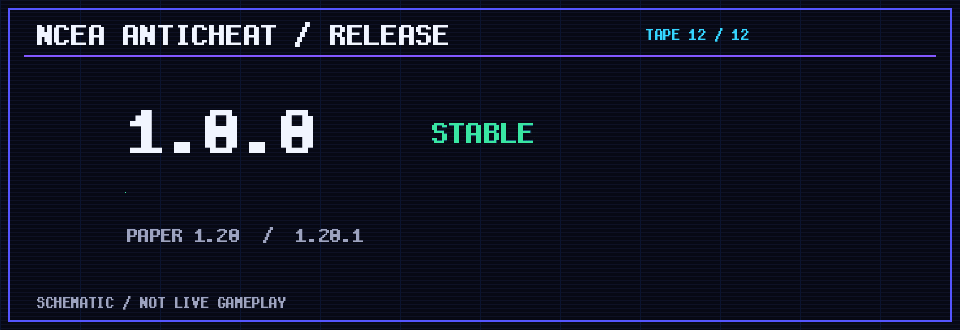</picture>

<details><summary>✉ Опись 01 · что уже работает</summary>

Пять проверок: **Speed**, **Fly**, **Reach**, **AutoClicker**, **FastPlace**. Есть исключения для легального движения, накопление и снижение VL, уведомления, команды и конфигурация. Пакетных проверок и предиктивной физики пока нет. [Точные ограничения](docs/KNOWN_LIMITATIONS.md).

</details>

<picture><source media="(prefers-reduced-motion: reduce)" srcset="docs/assets/angelos-adapted/divider.png" /></picture>

<picture><source media="(prefers-reduced-motion: reduce)" srcset="docs/assets/angelos-adapted/tape-02.ru.png" /></picture>

### 02 · Подключение к серверу

Возьмите **один** JAR под вашу версию Paper и положите его в `plugins/` сервера на Java 17. После запуска проверьте статус и созданные настройки.

<picture><source media="(prefers-reduced-motion: reduce)" srcset="docs/assets/angelos-adapted/demos/commands.png" />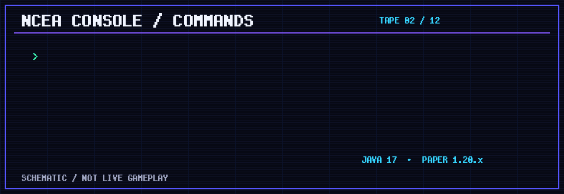</picture>

<details><summary>✉ Опись 02 · загрузки и первые команды</summary>

| Сервер | Файл |
|---|---|
| Paper 1.20 | [NCEA-AntiCheat-1.20.jar](https://github.com/Yozekkk/NCEA-anticheat/releases/download/v1.0.0/NCEA-AntiCheat-1.20.jar) |
| Paper 1.20.1 | [NCEA-AntiCheat-1.20.1.jar](https://github.com/Yozekkk/NCEA-anticheat/releases/download/v1.0.0/NCEA-AntiCheat-1.20.1.jar) |

```text
/nceaac status
/nceaac checks
/nceaac config validate
```

[Подробная установка](docs/INSTALLATION.md) · [Совместимость](docs/COMPATIBILITY.md).

</details>

<picture><source media="(prefers-reduced-motion: reduce)" srcset="docs/assets/angelos-adapted/divider.png" /></picture>

<picture><source media="(prefers-reduced-motion: reduce)" srcset="docs/assets/angelos-adapted/tape-03.ru.png" /></picture>

### 03 · Лента доказательств

Каждая проверка создаёт свой сигнал. Движок учитывает вес, порог, cooldown и снижение VL со временем. Отдельный необычный эпизод не является доказанным читом.

<picture><source media="(prefers-reduced-motion: reduce)" srcset="docs/assets/angelos-adapted/demos/violations.png" />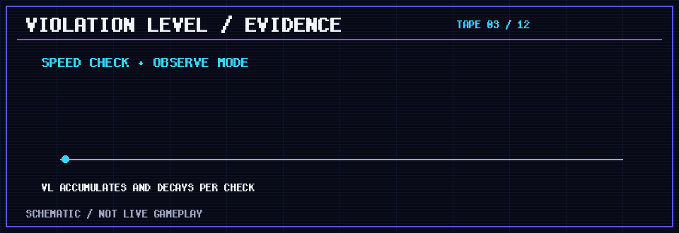</picture>

<details><summary>✉ Опись 03 · техническая модель</summary>

Проверки обрабатывают нормализованные события Paper; VL независим по проверке и игроку. Исключения и низкий TPS могут подавить сигнал. Последнее доказательство доступно через `/nceaac violations <player>`. [Устройство движка](docs/ARCHITECTURE.md) · [Параметры](docs/CONFIGURATION.md).

</details>

<picture><source media="(prefers-reduced-motion: reduce)" srcset="docs/assets/angelos-adapted/divider.png" /></picture>

<picture><source media="(prefers-reduced-motion: reduce)" srcset="docs/assets/angelos-adapted/tape-04.ru.png" /></picture>

### 04 · Координаты в движении

**Speed** анализирует горизонтальные смещения в коротком окне `PlayerMoveEvent`. **Fly** ищет длительное почти нулевое вертикальное смещение вне земли. Оба сигнала требуют контекста: телепортации, эффекты, отбрасывание и задержка сервера меняют допустимое движение.

<picture><source media="(prefers-reduced-motion: reduce)" srcset="docs/assets/readme/speed-demo.svg" />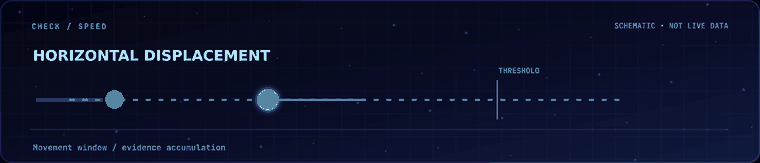</picture>
<picture><source media="(prefers-reduced-motion: reduce)" srcset="docs/assets/readme/fly-demo.svg" />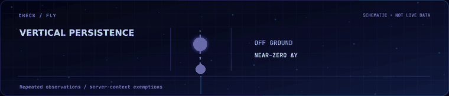</picture>

<details><summary>✉ Опись 04 · ложные срабатывания</summary>

Проверки эвристические и не моделируют всю физику Minecraft. Перед применением санкций изучайте доказательство, ping, TPS и обстоятельства движения. [Алгоритмы и ограничения](docs/CHECKS.md).

</details>

<picture><source media="(prefers-reduced-motion: reduce)" srcset="docs/assets/angelos-adapted/divider.png" /></picture>

<picture><source media="(prefers-reduced-motion: reduce)" srcset="docs/assets/angelos-adapted/tape-05.ru.png" /></picture>

### 05 · Момент удара

**Reach** измеряет расстояние от глаз атакующего до серверного hitbox цели. **AutoClicker** считает уникальные успешные атаки в секундном окне. Плагин пока не восстанавливает историю пакетов и не видит каждый физический клик мыши.

<picture><source media="(prefers-reduced-motion: reduce)" srcset="docs/assets/readme/reach-demo.svg" />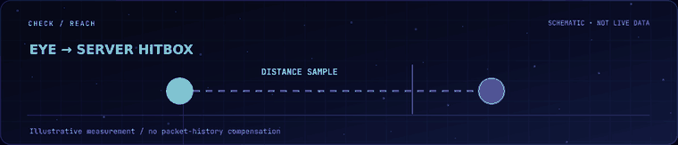</picture>
<picture><source media="(prefers-reduced-motion: reduce)" srcset="docs/assets/readme/autoclicker-demo.svg" />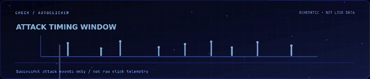</picture>

<details><summary>✉ Опись 05 · точность измерения</summary>

Сетевой ping и задержки учитываются консервативно. Отдельный быстрый удар не запускает наказание. [Пороги и методы](docs/CHECKS.md).

</details>

<picture><source media="(prefers-reduced-motion: reduce)" srcset="docs/assets/angelos-adapted/divider.png" /></picture>

<picture><source media="(prefers-reduced-motion: reduce)" srcset="docs/assets/angelos-adapted/tape-06.ru.png" /></picture>

### 06 · Блок за блоком

**FastPlace** оценивает интервалы между успешными установками. Это единственная реализованная world-проверка в версии 1.0.0; Scaffold, Nuker и другие проверки не заявлены как рабочие.

<picture><source media="(prefers-reduced-motion: reduce)" srcset="docs/assets/readme/fastplace-demo.svg" />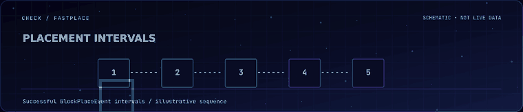</picture>

<details><summary>✉ Опись 06 · контекст</summary>

Серверная задержка, обычное быстрое строительство и временные исключения могут влиять на сигнал. Режим OBSERVE позволяет анализировать уведомления без автоматического наказания. [Справочник](docs/CHECKS.md).

</details>

<picture><source media="(prefers-reduced-motion: reduce)" srcset="docs/assets/angelos-adapted/cobweb-divider.png" />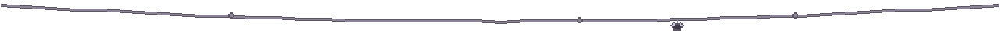</picture>

<picture><source media="(prefers-reduced-motion: reduce)" srcset="docs/assets/angelos-adapted/tape-07.ru.png" /></picture>

### 07 · Подстройка сигнала

`config.yml`, `checks.yml` и `branding.yml` создаются в `plugins/NCEAAntiCheat/`. Неверные значения не заменяют действующие настройки при reload.

<picture><source media="(prefers-reduced-motion: reduce)" srcset="docs/assets/readme/config-demo.svg" />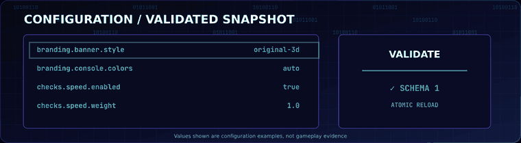</picture>

<details><summary>✉ Опись 07 · короткий фрагмент</summary>

```yaml
# checks.yml
checks:
  speed:
    enabled: true
    weight: 1.0
    decay: 0.15
    alert-threshold: 5.0
```

```text
/nceaac reload
/nceaac config validate
```

[Все настройки](docs/CONFIGURATION.md) · [Оформление](docs/CONFIG_REFERENCE.md).

</details>

<picture><source media="(prefers-reduced-motion: reduce)" srcset="docs/assets/angelos-adapted/cobweb-divider.png" /></picture>

<picture><source media="(prefers-reduced-motion: reduce)" srcset="docs/assets/angelos-adapted/tape-08.ru.png" /></picture>

### 08 · NCEA AC на экране запуска

Настоящая пиксельная геометрия консольного знака основана на [изображении владельца](Ascii/Ascii%20final%20result.png). Баннер выводится после успешной инициализации. Цветной Unicode, монохромный, ASCII, compact и custom доступны через `branding.yml`.

<picture><source media="(prefers-reduced-motion: reduce)" srcset="docs/assets/angelos-adapted/demos/paper-startup.png" />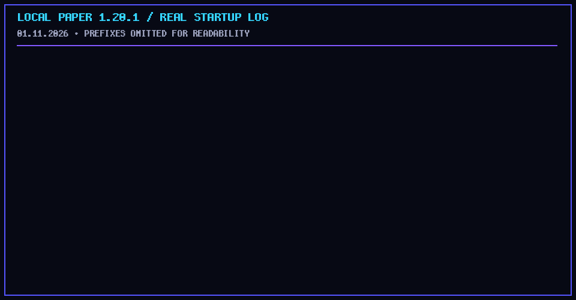</picture>

<details><summary>✉ Опись 08 · безопасный вывод</summary>

ANSI в автоматическом режиме включается осторожно; ошибочный терминал не должен блокировать загрузку плагина. [Руководство по баннеру](docs/CONSOLE_BRANDING.md) · [Свой шаблон](docs/BANNER_CUSTOMIZATION.md).

</details>

<picture><source media="(prefers-reduced-motion: reduce)" srcset="docs/assets/angelos-adapted/cobweb-divider.png" /></picture>

<picture><source media="(prefers-reduced-motion: reduce)" srcset="docs/assets/angelos-adapted/tape-09.ru.png" /></picture>

### 09 · Как проходит событие

`ncea-paper` принимает события и создаёт контекст. `ncea-core` хранит состояние игрока, проверки, VL и рендерер. Сборка компилирует общий код отдельно против Paper API 1.20 и 1.20.1.

<picture><source media="(prefers-reduced-motion: reduce)" srcset="docs/assets/readme/architecture.svg" />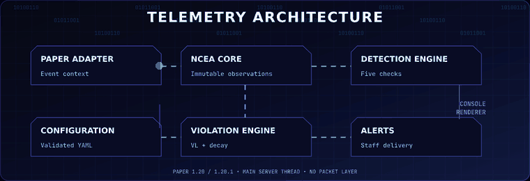</picture>

<details><summary>✉ Опись 09 · модули</summary>

Ядро не импортирует Bukkit. Paper API вызывается в подходящем серверном потоке. При выходе игрока его данные очищаются. [Архитектура](docs/ARCHITECTURE.md) · [Разработка](docs/DEVELOPMENT.md).

</details>

<picture><source media="(prefers-reduced-motion: reduce)" srcset="docs/assets/angelos-adapted/cobweb-divider.png" /></picture>

<picture><source media="(prefers-reduced-motion: reduce)" srcset="docs/assets/angelos-adapted/tape-10.ru.png" /></picture>

### 10 · Протокол, не обещание

**77 JUnit-тестов прошли, 0 ошибок.** Локальные Paper 1.20 и 1.20.1 на Java 17 прошли холодный и повторный запуск. Ядро покрыто JaCoCo по строкам на **81,4%**, Paper-адаптер — на **49,2%**.

<picture><source media="(prefers-reduced-motion: reduce)" srcset="docs/assets/readme/testing-panel.svg" />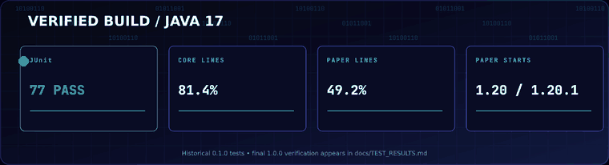</picture>

<details><summary>✉ Опись 10 · границы теста</summary>

Игровой клиент не подключался. Реальные доли обнаружения и ложных срабатываний, PvP-нагрузка и веб-консоль хостинга не измерены. [Протокол](docs/TEST_RESULTS.md) · [Методика](docs/TESTING.md) · [QA](docs/QA_REPORT.md).

</details>

<picture><source media="(prefers-reduced-motion: reduce)" srcset="docs/assets/angelos-adapted/cobweb-divider.png" /></picture>

<picture><source media="(prefers-reduced-motion: reduce)" srcset="docs/assets/angelos-adapted/tape-11.ru.png" /></picture>

### 11 · Навигация по досье

Пользовательские инструкции, описание проверок и руководство разработчика находятся в `docs/`. Основной текст остаётся доступным для поиска; иллюстрации дополняют его.

<picture><source media="(prefers-reduced-motion: reduce)" srcset="docs/assets/readme/documentation-panel.svg" />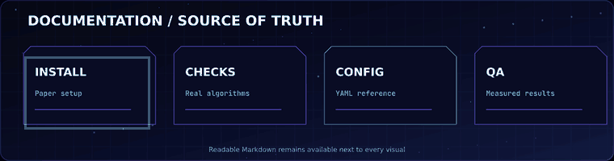</picture>

<details><summary>✉ Опись 11 · открыть документы</summary>

[Оглавление](docs/INDEX.md) · [Быстрый старт](docs/GETTING_STARTED.md) · [Команды](docs/COMMANDS.md) · [Права](docs/PERMISSIONS.md) · [Проверки](docs/CHECKS.md) · [Решение проблем](docs/TROUBLESHOOTING.md) · [История](docs/CHANGELOG.md).

</details>

<picture><source media="(prefers-reduced-motion: reduce)" srcset="docs/assets/angelos-adapted/cobweb-divider.png" /></picture>

<picture><source media="(prefers-reduced-motion: reduce)" srcset="docs/assets/angelos-adapted/tape-12.ru.png" /></picture>

### 12 · Конец записи, начало работы

**NCEA Studio** выпускает этот продукт как **1.0.0 Stable** для Paper 1.20/1.20.1. Следующие направления — пакетный слой, более точная физика и игровые испытания. Сейчас они не объявлены реализованными.

<picture><source media="(prefers-reduced-motion: reduce)" srcset="docs/assets/angelos-adapted/demos/stable-release.png" /></picture>

<details><summary>✉ Опись 12 · права, происхождение и выпуск</summary>

Код NCEA находится под [All rights reserved](LICENSE). Адаптированные SVG AngelOS сохраняют **MIT © 2026 MixaDoDs**; встроенные шрифты имеют отдельные MIT/OFL-уведомления. [Точная атрибуция](docs/ASSET_CREDITS.md) · [Визуальный аудит](docs/README_VISUAL_AUDIT.md) · [Общий аудит](docs/THIRD_PARTY_AUDIT.md) · [Release Notes](docs/RELEASE_NOTES_1.0.0.md).

</details>

<picture><source media="(prefers-reduced-motion: reduce)" srcset="docs/assets/angelos-adapted/end.ru.png" /></picture>

<div align="center">

[NCEA Studio](https://ncea-studio.com) · [GitHub Release](https://github.com/Yozekkk/NCEA-anticheat/releases/tag/v1.0.0) · [English](README.en.md)

</div>
