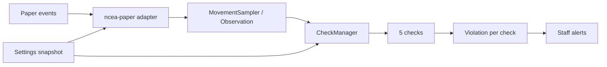

# Архитектура

| Модуль | Ответственность |
|---|---|
| `ncea-core` | Наблюдения, выборка движений, независимые проверки, VL/decay, сессии игроков, решение о правах, модель баннера. Не импортирует Paper. |
| `ncea-paper` | Адаптер событий Paper, контекстные исключения, YAML, команды, вывод Adventure и логгер. Один исходный набор отдельно компилируется против API 1.20 и 1.20.1. |

Обработчики событий работают на главном потоке сервера; состояние `PlayerData` и `PlayerRegistry` также принадлежит этому потоку. `PlayerQuitEvent` удаляет сессию, `onDisable` очищает карты и наборы. В hot path нет дискового ввода/вывода; YAML читается только при старте и ручном `/nceaac reload`. Плагин не создаёт собственных задач или потоков.

`MovementSampler` объединяет события в окно от 45 мс, пропускает повторную позицию, сбрасывается при небезопасном контексте и отдаёт immutable `Observation`. `CheckManager` вычисляет только включённые проверки. `Settings` валидирует новый набор и заменяет живую конфигурацию только после успеха. Недостающие ключи баннера в конфигурации схемы 1 записываются с резервной копией. `BannerRenderer` формирует Unicode/ASCII и ANSI-строки независимо от Paper; `BrandingLoader` валидирует `branding.yml`, а адаптер печатает баннер после успешной инициализации.

Пакетного слоя, NMS, базы данных, системы санкций и прогноза коллизий в этом выпуске нет. Расширение должно сохранять границу потоков и доказательства по каждой проверке.
